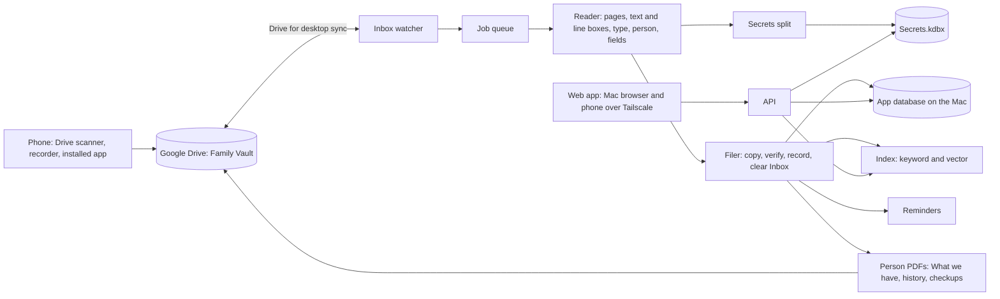

# Architecture

## Overview

The vault is a web app that runs on my Mac. Files live in a `Family Vault` folder inside the folder that Google Drive for desktop syncs, so the phone can open them through the Drive app. The app reads and writes ordinary files there and keeps its own database on the Mac's disk. It never makes Drive API calls.

## Components

- **Inbox watcher.** Notices a new file in `Inbox`, waits until Drive has finished syncing it, and checks that it opens, is not empty, is a supported type and is not a duplicate (SHA-256).
- **Job queue.** Jobs are stored in SQLite. One worker runs one model-heavy job at a time so the models fit in 16 GB.
- **Reader.** On the Mac only. Apple Vision text recognition, through `ocrmac`, returns each page's text with line positions ([ADR 0008](decisions/0008-reading-engine.md)). qwen3-vl:4b, run through Ollama, reads the page image and fills the type's JSON schema ([ADR 0009](decisions/0009-extraction-model-and-runtime.md)); qwen3:4b on the OCR text is the fallback. Every output is checked against its schema and by code: dates are real dates, totals add up, card numbers pass the Luhn check.
- **Transcriber.** On the Mac only. Parakeet TDT 0.6B v2, through `parakeet-mlx`, turns a visit recording into a timestamped transcript. Each medicine name in the draft checkup is matched against that visit's prescription and a list of known medicine names, and a name that matches neither waits for my confirmation ([ADR 0011](decisions/0011-transcription-model.md)).
- **Secrets split.** Card numbers, CVV, PINs and passwords are taken out of the reader's output and written to `Secrets.kdbx`. The rest continues to the filer. A card photo is stored as a protected attachment in its KeePass entry and a masked copy is filed.
- **Filer.** Copies the file to its folder, confirms the copy's fingerprint, writes the record JSON, updates the database and index, then clears `Inbox`. Undo moves the file back and removes the record.
- **Index.** SQLite full-text search for keywords (policy numbers, serial numbers) and a vector index in the same database for meaning.
- **Reminders.** Built from extracted dates with lead times per kind of date.
- **PDF writer.** HTML templates rendered to PDF for checkups, medical histories, What we have pages and the emergency sheet.
- **API.** Python and FastAPI with Pydantic models at every boundary. It listens on localhost only.
- **Web app.** React, TypeScript and Vite, installable on the phone, keyboard-first on the Mac, with a page viewer that draws line outlines.
- **Tracing.** Local tracing of each pipeline run and search, with IDs masked and secrets never recorded.

## Data flow for one document

1. A paper is scanned with the Drive app on the phone into `Inbox`, or an invoice PDF is saved there.
2. Drive for desktop syncs it to the Mac. The watcher waits for the sync to finish, then checks the file and fingerprints it.
3. A job is queued. The reader renders page images, extracts text with the position of every line, decides the document type and whose it is, and fills the fields for that type.
4. The secrets split removes anything secret and writes it to `Secrets.kdbx`.
5. If the type or the person is below the confidence threshold, or required fields are missing, the file moves to `Needs a look` with the reason and the app asks one question.
6. Otherwise the filer copies the file to `<Person>/<Area>/<date> <name>.<ext>`, confirms the copy's fingerprint, writes `_system/records/<id>.json`, updates the database and the index, and removes the file from `Inbox`.
7. Reminders are created from the extracted dates, and the owner's What we have PDF is rewritten.
8. Every step is written to the activity log in the database and to `_system/log/<YYYY-MM>.csv`.

## Where data lives

| Data | Where | Why there |
|---|---|---|
| Original and filed documents | `Family Vault/` in the Drive-synced folder, unencrypted | The phone opens them through the Drive app |
| One JSON record per document (type, person, fields, page boxes) | `Family Vault/_system/records/` | The database can be rebuilt from the files and these records |
| Activity log | `_system/log/`, one CSV per month | Readable on the phone |
| App database (people, documents, pages, line boxes, fields, events, reminders, checkups, history entries, secret entry IDs, settings) | The Mac's disk, outside Drive | Sync tools corrupt live SQLite files |
| Nightly database copy | `_system/backup/` | A restore point that Drive keeps safe |
| Card numbers, CVV, PINs, passwords | `Secrets.kdbx`, written only by the app | Encrypted with a master password; opens in any KeePass app |
| Real vault path and app config | The installed app's local config on the Mac | Never in this repository |

## Threats and what the design does

| Threat | What the design does |
|---|---|
| A document carries instructions ("ignore previous rules...") | Document text is data. Models only fill fixed schemas; nothing a document says triggers an action; outputs are validated |
| Secrets leak into plain storage or a model | Secrets go only to `Secrets.kdbx`; a leak test scans the database, index, logs, traces and Drive files on every eval run |
| Someone else on a network the phone uses | The app is not on the public internet; only my Tailscale devices reach it, over HTTPS, and it needs sign-in |
| Lost or stolen phone | Remove the device from Tailscale and end its app session; secrets need the master password |
| Lost or stolen Mac | Setup checks that FileVault disk encryption is on; the KeePass file needs the master password |
| My Google account is broken into | Plain documents are readable (an accepted trade-off, ADR 0002); `Secrets.kdbx` is not. The README recommends 2-step verification on the Google account |
| A misread document filed in the wrong place | Thresholds send doubtful files to `Needs a look`; Undo; the misfiling rate is a tracked eval metric |
| Real data reaches the public repo or a cloud model | The repo holds code and synthetic data only; the cloud comparison runs only on the synthetic set and refuses the real vault path |
| Accidental loss | Originals are never changed; Undo; nothing is deleted outside Drive's own trash without a confirm |

## Decisions

The reasoning behind the main choices is in `docs/decisions/`:

- 0001 The app runs only on my Mac
- 0002 Files live in Google Drive through the desktop app
- 0003 Search, not chat
- 0004 Secrets go in a KeePass file
- 0005 The phone reaches the app over Tailscale
- 0006 The database stays on the Mac
- 0007 The fine-tune uses PyTorch on a free GPU
- 0008 Pages are read with Apple's built-in text recognition
- 0009 Fields are filled by a small vision model reading the page image
- 0010 The fine-tune path: LoRA in PyTorch, merged and converted to GGUF for Ollama
- 0011 Visits are transcribed with Parakeet, and medicine names are checked before a note is saved
