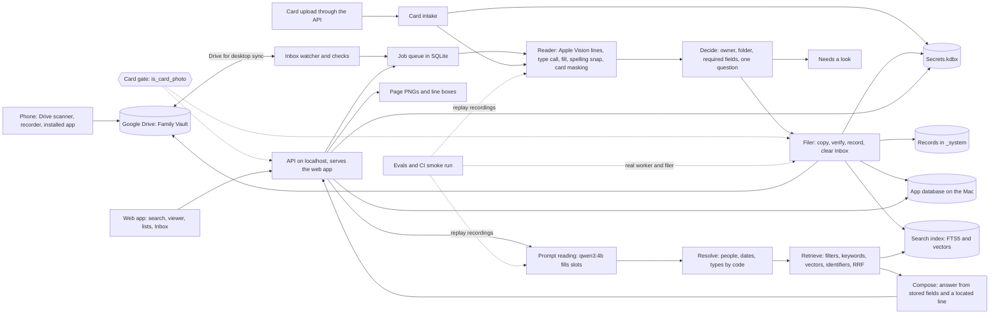

# Architecture

## Overview

The vault is a web app that runs on my Mac. Files live in a `Family Vault` folder inside the folder that Google Drive for desktop syncs, so the phone can open them through the Drive app. The app reads and writes ordinary files there and keeps its own database on the Mac's disk. It never makes Drive API calls.

Not built yet, and drawn in the plan only: reminders, the person PDFs, tracing and the transcriber (M4 and M5).

## Components

Built in M2:

- **Inbox watcher and checks.** Polls `Inbox`, ignores hidden and temporary names, and waits until a file's size and time have stopped changing, so Drive has finished syncing it. Then it checks that the file opens, is not empty, is a supported type and is not a duplicate by SHA-256. A file that fails goes to `Needs a look` with the reason.
- **Job queue and worker.** Items and their state live in SQLite. One worker runs one model-heavy job at a time so the models fit in 16 GB. A drive outage pauses work instead of ending files as gone.
- **Reader.** On the Mac only. Apple Vision, through `ocrmac`, returns each page's text with line positions ([ADR 0008](decisions/0008-reading-engine.md)). A type call to the local model reads that text, masked, and answers with a type; title cues check it ([ADR 0015](decisions/0015-document-type-from-text-and-title-cues.md)). qwen3-vl:4b, run through Ollama, then reads the page image and fills the type's JSON schema, copying dates, amounts and names as printed ([ADR 0009](decisions/0009-extraction-model-and-runtime.md), [ADR 0017](decisions/0017-values-read-as-printed-and-the-spelling-snap.md)). The app parses the dates and amounts, checks every field against its schema (dates are real dates, card and ID numbers pass their checksums), and the spelling snap fixes a misspelt name from the page's own text. qwen3:4b on the OCR text is the fallback when no vision model runs.
- **Card masking.** Card fields and stored line text are masked by card shape before anything is stored, and a card photo's number line is blacked out in the filed copy (ADR 0014).
- **Decide.** A pure function from a reading, the household and what is already filed to a decision: owner, linked people, folder, date, description, or one question. Owner rules, required fields and copy keys are per type ([ADR 0013](decisions/0013-who-owns-a-document-and-when-to-ask.md)).
- **Filer.** Copies the file to its folder, confirms the copy's SHA-256, writes the record JSON and the database rows, then clears `Inbox`. Every move writes its intent first, so a stop at any point is finished or rolled back by `recover` from the database and the files. Undo moves a file back and removes its record. Discard only deletes when another copy verifies by hash ([ADR 0012](decisions/0012-record-json-and-database.md)).
- **Secrets store and gate.** `Secrets.kdbx` is written only by the app. The master password unlocks it for 10 minutes in memory. Card photos that arrive while it is locked wait and are filed when it opens. One gate, `is_card_photo`, is asked by every route that serves, moves or files raw bytes ([ADR 0014](decisions/0014-secrets-in-the-filing-pipeline.md)).
- **API.** Python and FastAPI with Pydantic models at every boundary. It listens on localhost only and refuses cross-site posts and a body that grows past its limit. It lists activity and Inbox progress, the `Needs a look` questions and answers (one at a time or many), unlock, Undo, retry, document files and the card upload, and in M3 search, lists, page images and line boxes. It also serves the built web app from the same origin.
- **Evals and the CI smoke run.** A reading eval and a filing eval score the reader and the real worker on `eval-v1` ([ADR 0016](decisions/0016-synthetic-eval-set-v1.md)). Recordings of model answers let the filing eval, and a 22-document smoke run in CI, replay a run with no model.

Built in M3:

- **Search index.** SQLite FTS5 over each document's stored line text and fields, and an exact vector index (`qwen3-embedding:0.6b`, 1,024 dimensions) held in memory. Both are updated in the filer's own transactions and by embed jobs in the worker ([ADR 0018](decisions/0018-the-search-index-in-sqlite.md)).
- **Prompt reading.** `qwen3:4b` sees only the prompt and a fixed vocabulary and fills slots (intent, people, types, field, date phrase, place) as the words the prompt used ([ADR 0019](decisions/0019-the-model-reads-the-prompt-code-does-the-rest.md)).
- **Resolve.** Code turns the slots into a query: people from the household, dates from a date parser that knows the year end and the financial year, types from the type words, and the list cue with a question guard. Anything it cannot read is reported, never guessed.
- **Retrieve.** Filters on the stored fields, the keyword ranking, the vector ranking and, for an identifier-shaped word, a field-rows ranking, fused by reciprocal rank fusion into one row per document.
- **Compose.** Code writes the answer from the best row that fits the person and type, shows it only with a located line on the page, and otherwise says there is no direct answer and lists the closest files ([ADR 0020](decisions/0020-answers-from-fields-with-a-located-line.md)). Lists are returned with a sentence that says how the prompt was read, and each part can be changed without another model call.
- **Pages.** The server renders each page to a PNG and returns its line boxes, so the viewer needs no PDF viewer under the content security policy, and a card is drawn only from its masked copy ([ADR 0022](decisions/0022-the-apps-own-page-viewer.md)).
- **Web app.** React, TypeScript and Vite, built once and served by the API from one origin with `default-src 'self'`: no fonts, scripts or images from anywhere else. Screens: search with the answer beside the page, a document viewer with the outlined line, lists and areas, and the Inbox with its questions, password and secrets dialogs. Types are generated from the API's own description. Keyboard first on the Mac; the phone layout is checked and the installable phone app is M4.
- **Search eval.** `search-v1` and its runner score search on a synthetic vault of a split, with recordings of readings and vectors so CI replays a run with no model ([ADR 0021](decisions/0021-the-search-v1-eval-set.md)).

Planned, from M4:

- **Transcriber (M5).** On the Mac only. Parakeet TDT 0.6B v2, through `parakeet-mlx`, turns a visit recording into a timestamped transcript. Each medicine name in the draft checkup is matched against that visit's prescription and a list of known medicine names, and a name that matches neither waits for my confirmation ([ADR 0011](decisions/0011-transcription-model.md)).
- **Reminders.** Built from extracted dates with lead times per kind of date.
- **PDF writer.** HTML templates rendered to PDF for checkups, medical histories, What we have pages and the emergency sheet (the emergency sheet exists as a command already).
- **Phone app.** The same screens installable on the phone, reached over Tailscale.
- **Tracing.** Local tracing of each pipeline run and search, with IDs masked and secrets never recorded.

## Data flow for one search

1. I type in the box. The quick finder runs on every keystroke with no model call: keywords and vectors, fused, as rows with type, person, key fields and path.
2. On Enter the full search runs. `qwen3:4b` reads the prompt into slots, code resolves them, and the app either looks up one value, finds a document or lists documents.
3. Retrieval filters on the stored fields and fuses the keyword and vector rankings.
4. Compose writes the answer from the best row that fits the person and type, and finds the line on the page that prints it.
5. The screen shows the answer beside the page, with the line outlined and its path. A list shows its sentence, with each part a menu. When nothing supports an answer, it says so and shows the closest files.
6. The prompt is never stored or logged; only its length reaches a log.

## Data flow for one document

1. A paper is scanned with the Drive app on the phone into `Inbox`, or an invoice PDF is saved there.
2. Drive for desktop syncs it to the Mac. The watcher waits for the sync to finish, then checks the file and fingerprints it.
3. A job is queued. The reader renders page images, extracts text with the position of every line, asks the model for the document type from that text, and fills the fields for that type from the page image.
4. Anything secret is taken out of the reading and written to `Secrets.kdbx`, and card numbers are masked in everything that is stored.
5. The decision step works out whose it is. If the type is doubtful, a name matches nobody or two people, or required fields are missing, the file moves to `Needs a look` with the reason and the app asks one question.
6. Otherwise the filer copies the file to `<Person>/<Area>/<date> <name>.<ext>`, confirms the copy's fingerprint, writes `_system/records/<id>.json`, updates the database and the index, and removes the file from `Inbox`.
7. (M4) Reminders are created from the extracted dates, and the owner's What we have PDF is rewritten.
8. Every step is written to the activity log in the database and to `_system/log/<YYYY-MM>.csv`.

## Where data lives

| Data | Where | Why there |
|---|---|---|
| Original and filed documents | `Family Vault/` in the Drive-synced folder, unencrypted | The phone opens them through the Drive app |
| One JSON record per document (type, person, fields, page boxes) | `Family Vault/_system/records/` | The database can be rebuilt from the files and these records |
| Activity log | `_system/log/`, one CSV per month | Readable on the phone |
| App database (people, documents, pages, line boxes, fields, events, reminders, checkups, history entries, secret entry IDs, settings) | The Mac's disk, outside Drive | Sync tools corrupt live SQLite files |
| Nightly database copy | `_system/backup/` | A restore point that Drive keeps safe |
| Card numbers, CVV, PINs, passwords | `Secrets.kdbx`, written only by the app | Encrypted with a master password; opens in any KeePass app |
| Real vault path and app config | The installed app's local config on the Mac | Never in this repository |

## Threats and what the design does

| Threat | What the design does |
|---|---|
| A document carries instructions ("ignore previous rules...") | Document text is data. Models only fill fixed schemas; nothing a document says triggers an action; outputs are validated |
| Secrets leak into plain storage or a model | Secrets go only to `Secrets.kdbx`; one gate keeps raw card photos from being served, moved or filed; a leak scan covers the vault, database and logs on every eval run (ADR 0014) |
| Someone else on a network the phone uses | The app is not on the public internet; only my Tailscale devices reach it, over HTTPS, and it needs sign-in |
| Lost or stolen phone | Remove the device from Tailscale and end its app session; secrets need the master password |
| Lost or stolen Mac | Setup checks that FileVault disk encryption is on; the KeePass file needs the master password |
| My Google account is broken into | Plain documents are readable (an accepted trade-off, ADR 0002); `Secrets.kdbx` is not. The README recommends 2-step verification on the Google account |
| A misread document filed in the wrong place | Rules send doubtful files to `Needs a look` (ADR 0013); Undo; the misfiling rate is a tracked eval metric (0 silent misfiles per 100 on the test split) |
| A search answers from someone else's document | An unknown person declines; an answer needs a located line and a row that fits the person and type; the soft place filter is a known gap (ADR 0020) |
| A card number typed into the search box | Masked to its last four once complete, in the address and before any model sees it; the digits before it is complete are a known window (ADR 0020) |
| Real data reaches the public repo or a cloud model | The repo holds code and synthetic data only; the cloud comparison runs only on the synthetic set and refuses the real vault path |
| Accidental loss | Originals are never changed; Undo; nothing is deleted outside Drive's own trash without a confirm |

## Decisions

The reasoning behind the main choices is in `docs/decisions/`:

- 0001 The app runs only on my Mac
- 0002 Files live in Google Drive through the desktop app
- 0003 Search, not chat
- 0004 Secrets go in a KeePass file
- 0005 The phone reaches the app over Tailscale
- 0006 The database stays on the Mac
- 0007 The fine-tune uses PyTorch on a free GPU
- 0008 Pages are read with Apple's built-in text recognition
- 0009 Fields are filled by a small vision model reading the page image
- 0010 The fine-tune path: LoRA in PyTorch, merged and converted to GGUF for Ollama
- 0011 Visits are transcribed with Parakeet, and medicine names are checked before a note is saved
- 0012 One record file per document, and a database on the Mac that the records can rebuild
- 0013 Who owns a document, where it goes, and when the app asks instead
- 0014 How secrets are kept out of everything the filing pipeline writes
- 0015 The document type comes from the page's text, and title cues only check the model
- 0016 A synthetic eval set of 50 document types, scored once on a held-out split
- 0017 Values are read as printed and converted by code, and spelling slips are fixed from the page's own text
- 0018 The search index lives in SQLite, with exact vectors held in memory
- 0019 The model reads the prompt, and code works out the rest
- 0020 An answer comes from stored fields and a located line, or the app says there is none
- 0021 The search-v1 eval set, tuned on validation and scored once on test
- 0022 The app draws the page itself: server-rendered PNGs and the line outline
